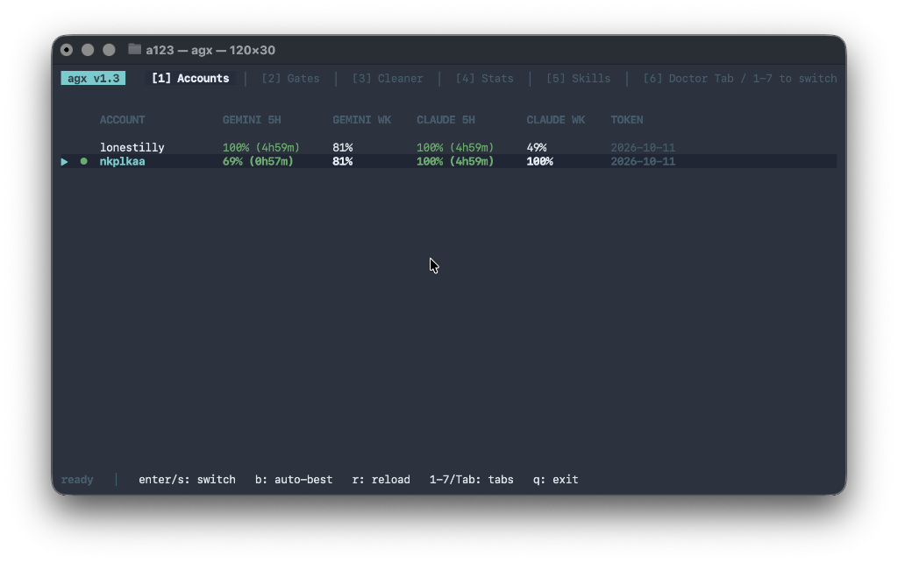
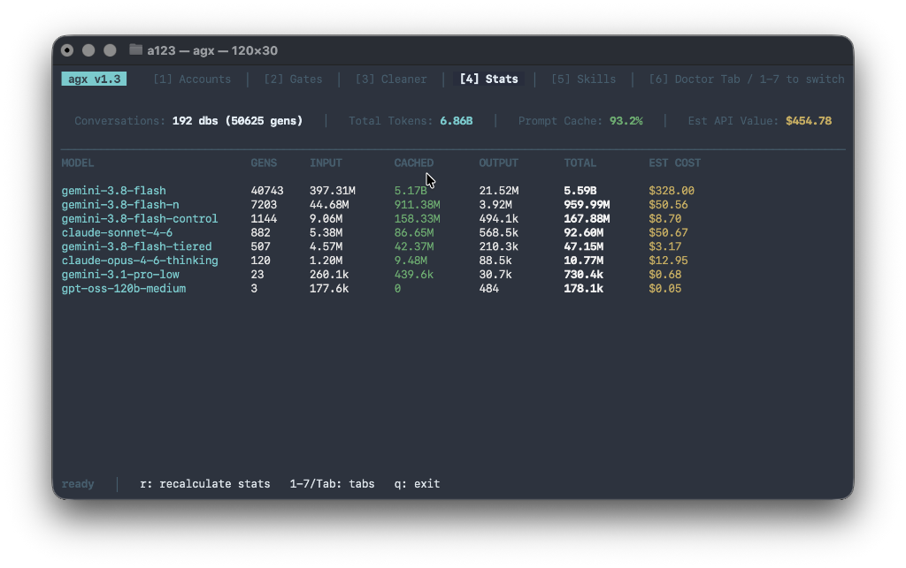
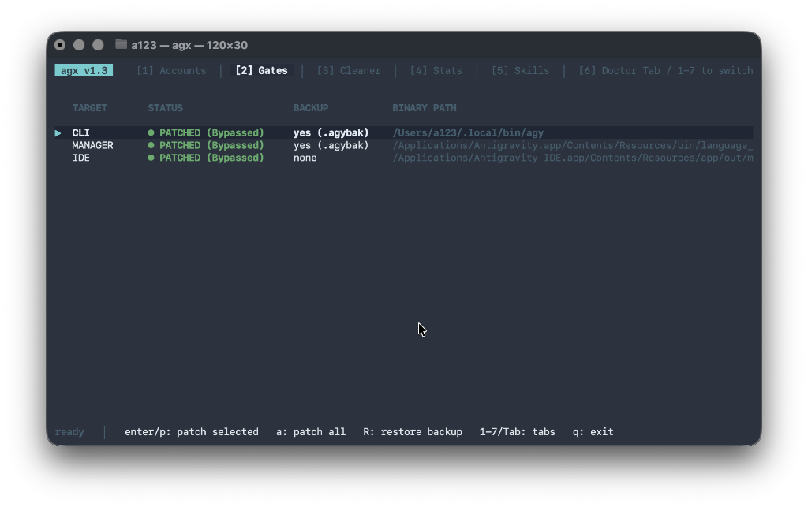
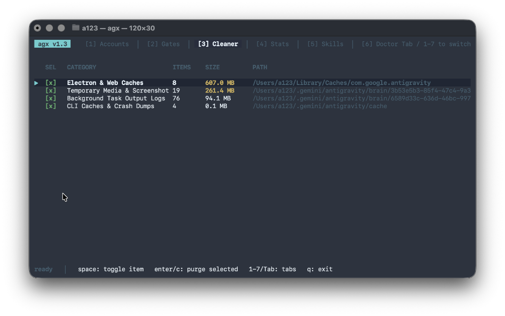
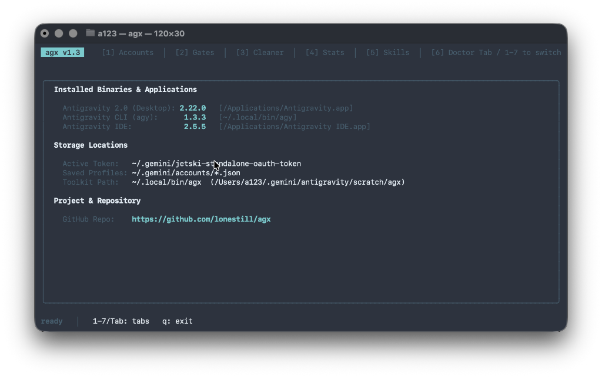

# agx

[](https://github.com/lonestill/agx/releases/latest)
[](https://github.com/lonestill/agx/actions)
[](LICENSE)
[](https://github.com/lonestill/agx/releases/latest)
[](https://www.rust-lang.org)

**Universal high-performance multitool for Google Antigravity & Jetski** — multi-account switcher, quota auto-rotator, binary gate patcher, token analytics, and interactive TUI.

<p align="center">
  
</p>

[English](#english) • [Русский](#русский) • [עברית](#עברית)

---

## English

A native, zero-bullshit multitool for Google Antigravity & Jetski. Written in Rust.

Launches a 7-tab interactive TUI dashboard by default, with dedicated CLI subcommands for automation and scripting.

### Installation

**One-line automatic install (macOS & Linux):**

```bash
curl -fsSL https://raw.githubusercontent.com/lonestill/agx/master/install.sh | bash
```

Or download pre-built native binaries from [GitHub Releases](https://github.com/lonestill/agx/releases/latest):

| OS / Architecture | Package |
|---|---|
| **macOS Universal** (M1–M4 & Intel) | `agx-v*-macos-universal.tar.gz` |
| **macOS Apple Silicon** (arm64) | `agx-v*-macos-arm64.tar.gz` |
| **macOS Intel** (x86_64) | `agx-v*-macos-x86_64.tar.gz` |
| **Linux** (x86_64) | `agx-v*-linux-x86_64.tar.gz` |
| **Windows** (x86_64 MSVC) | `agx-v*-windows-x86_64.zip` |

Or compile from source:

```bash
git clone https://github.com/lonestill/agx.git
cd agx
cargo build --release
# Binary placed at target/release/agx
```

### What it does

1. **Multi-Account & Quota Auto-Rotation**:
   - Stores multiple Google OAuth profiles (`~/.gemini/accounts/`).
   - Live 5-hour rolling and weekly quota countdowns.
   - `agx account best` automatically rotates to the account with the highest available quota.
2. **Token & Cost Analytics (`agx stats`)**:
   - Directly inspects Antigravity conversation SQLite databases (`~/.gemini/antigravity/conversations/*.db`).
   - Decodes protobuf metadata at ~25,000 generations/second.
   - Calculates prompt cache hit rates and estimated API cost per model.
   - *Note: `agx stats` is currently not supported on Windows (macOS & Linux only).*
3. **Surgical Storage Cleaner (`agx clean`)**:
   - Reclaims ~1 GB of disposable Chromium V8 caches, GPU shaders, and background task process logs.
   - **Guaranteed safe**: strict hardcoded blacklist permanently blocks chats, transcripts, projects (`scratch/`), and tokens.
   - Interactive checkbox selection with explicit confirmation (`[y/N]`).
4. **Binary Gate Patcher (`agx patch`)**:
   - Inspects and patches authentication & eligibility gates in `agy` CLI, `language_server`, and IDE `main.js`.
   - Automatic `.agybak` backups and macOS ad-hoc code-signing (`codesign -f -s -`).
5. **System Health Doctor (`agx doctor`)**:
   - Pings Google OAuth2 and CloudCode endpoints with live RTT measurement.
   - Audits token expiry, helper processes, and code signatures.
6. **Agent Skills Manager (`agx skills`)**:
   - Scans, validates frontmatter, audits integrity, and scaffolds new agent skills in `~/.gemini/config/skills/`.
7. **Isolated Command Runner (`agx run`)**:
   - Temporarily swaps credentials, runs a command under another profile, and restores your active token even if the process exits with an error.

### Quick Start

```bash
# Launch interactive TUI (Default)
agx

# Run system health check
agx doctor

# Check conversation token usage & estimated API cost
agx stats

# Switch to the account with the most remaining quota
agx account best

# Clean disposable caches safely (prompts [y/N])
agx clean
```

### TUI Tabs & Hotkeys

| Tab | Name | Key Features |
|---|---|---|
| `[1]` | **Accounts** | Profile list, live 5h/weekly quotas, `Enter`/`s` to switch, `b` for auto-best, `r` to reload |
| `[2]` | **Gates** | Binary patch states, `Enter`/`p` to patch, `a` to patch all, `R` to restore original `.agybak` |
| `[3]` | **Cleaner** | Disposable cache categories, `Space` to toggle, `Enter`/`c` to clean selected |
| `[4]` | **Stats** | Model breakdown, input/cached/output tokens, cost calculation, `r` to refresh |
| `[5]` | **Skills** | Two-pane skill browser, audit status (`[OK]`/`[ERR]`), `j`/`k` to browse details, `r` to rescan |
| `[6]` | **Doctor** | API latency pings, signature checks, process audit, `r` to re-run |
| `[7]` | **System** | Application versions, file paths, and repository info |

**Global Navigation**: `1`-`7` jump to tab • `Tab` / `Shift+Tab` cycle tabs • `j`/`k` or `↑`/`↓` navigate items • `q`/`Esc` exit.

<p align="center">
  
  
</p>
<p align="center">
  
  
</p>

### CLI Reference

```bash
agx                             # Interactive TUI dashboard
agx account ls                  # List saved profiles
agx account switch <name>       # Switch active profile
agx account best                # Auto-switch to best quota
agx account save <name>         # Snapshot active credentials
agx quota [--all]               # Check quota from terminal
agx stats                       # Token & cost summary
agx doctor                      # System health check
agx skills ls                   # List installed agent skills
agx skills check                # Audit YAML frontmatter
agx skills new <name>           # Scaffold new skill
agx run -a <account> -- <cmd>   # Isolated one-shot execution
agx clean                       # Interactive cache purge
agx patch status                # Check binary gates
agx patch apply all             # Patch CLI, Manager, and IDE
agx export [file.tar.gz]        # Export vault backup
agx import <file.tar.gz>        # Restore vault backup
agx info                        # Environment & versions
```

---

## Русский

Нативный швейцарский нож для Google Antigravity и Jetski на Rust. Без корпоративной воды и раздутого UI.

По умолчанию запускает 7-вкладочный интерактивный TUI-дашборд. Любая команда также доступна через CLI для скриптов и автоматизации.

### Установка

Готовые бинарники для всех платформ лежат в [GitHub Releases](https://github.com/lonestill/agx/releases/latest) (macOS Universal/ARM/Intel, Linux x86_64, Windows x64).

Либо сборка из исходников:

```bash
git clone https://github.com/lonestill/agx.git
cd agx
cargo build --release
```

### Основные возможности

1. **Мультиаккаунты и авторотация квот**:
   - Управление профилями Google OAuth в `~/.gemini/accounts/`.
   - Мониторинг 5-часовых и недельных скользящих лимитов с таймером сброса.
   - `agx account best` моментально находит аккаунт с максимальной свободной квотой и переключается на него.
2. **Аналитика токенов и затрат (`agx stats`)**:
   - Читает базы данных переписок Antigravity (`~/.gemini/antigravity/conversations/*.db`).
   - Парсит varint/protobuf метаданные со скоростью ~25 000 генераций/сек.
   - Считает процент попадания в промпт-кэш и расчётную стоимость по моделям.
   - *Примечание: на данный момент функция `agx stats` не поддерживается на Windows (только macOS и Linux).*
3. **Безопасная очистка кэша (`agx clean`)**:
   - Находит около 1 GB мусора: кэш Chromium V8, шейдеры GPU, логи stdout/stderr фоновых задач.
   - **Гарантия безопасности**: жесткий блэклист в коде навсегда блокирует доступ к базам чатов, транскриптам диалогов, папкам проектов (`scratch/`) и токенам.
   - Выбор категорий чекбоксами и строгое подтверждение перед удалением (`[y/N]`).
4. **Патчер бинарников (`agx patch`)**:
   - Находит и снимает проверки доступности и авторизации в `agy`, `language_server` и `main.js`.
   - Автоматически создает бэкапы `.agybak` и переподписывает код через `codesign -f -s -`.
5. **Диагностика системы (`agx doctor`)**:
   - Замеряет пинг до Google OAuth и CloudCode API в миллисекундах.
   - Проверяет срок действия токенов, запущенные процессы и целостность подписей.
6. **Менеджер скиллов (`agx skills`)**:
   - Просмотр, аудит структуры и создание новых скиллов агента в `~/.gemini/config/skills/`.
7. **Изолированный запуск (`agx run`)**:
   - Временно подменяет токен на указанный профиль, выполняет команду и гарантированно возвращает активный токен на место, даже если команда упала с ошибкой.

### Управление в TUI

- `1`..`7` — прямой переход на вкладку
- `Tab` / `Shift+Tab` — переключение вкладок по кругу
- `j` / `k` или `↑` / `↓` — выбор строки в текущей вкладке
- `Enter` / `s` — переключить аккаунт (вкладка 1) / применить патч (вкладка 2)
- `b` — автовыбор аккаунта с лучшей квотой (вкладка 1)
- `Space` — переключить чекбокс очистки (вкладка 3)
- `c` — удалить выбранный кэш (вкладка 3)
- `r` — обновить данные (квоты, токены, скиллы или диагностику)
- `q` / `Esc` — выход

---

## עברית

כלי עבודה מקורי, מהיר ומדויק עבור Google Antigravity ו-Jetski, כתוב ב-Rust. ללא שכבות מיותרות או ממשק מסורבל.

בהרצה רגילה מפעיל ממשק TUI אינטראקטיבי עם 7 לשוניות. כל היכולות זמינות גם כפקודות CLI לאוטומציה וסקריפטים.

### התקנה

קבצים בינאריים מוכנים להורדה זמינים ב-[GitHub Releases](https://github.com/lonestill/agx/releases/latest) (עבור macOS, Linux ו-Windows).

או הידור ישיר מקוד המקור:

```bash
git clone https://github.com/lonestill/agx.git
cd agx
cargo build --release
```

### יכולות מרכזיות

1. **ניהול חשבונות ורוטציית מכסות אוטומטית**:
   - שמירה ומעבר בין חשבונות Google OAuth (`~/.gemini/accounts/`).
   - מעקב בזמן אמת אחרי חלונות מכסה (5 שעות ושבועי) עם זמני איפוס.
   - הפקודה `agx account best` מאתרת את החשבון בעל המכסה הגבוהה ביותר ועוברת אליו אוטומטית.
2. **ניתוח טוקנים ועלויות (`agx stats`)**:
   - קורא ישירות את מסדי הנתונים של השיחות ב-SQLite (`~/.gemini/antigravity/conversations/*.db`).
   - מפענח נתוני Protobuf במהירות של כ-25,000 בקשות בשנייה.
   - מחשב יעילות מטמון (Prompt Caching) ועלות משוערת לפי דגם.
   - *הערה: פקודת `agx stats` אינה נתמכת כרגע ב-Windows (זמינה ב-macOS ו-Linux בלבד).*
3. **ניקוי מטמון בטוח ומדויק (`agx clean`)**:
   - מפנה כ-1 GB של קבצי מטמון (Chromium V8, שיידרים של GPU, ולוגים של משימות רקע).
   - **הגנה מוחלטת**: מנגנון נעילה קשיח מונע מחיקה של היסטוריית שיחות, פרויקטים (`scratch/`), קבצי משתמש ומפתחות.
   - בחירה אינטראקטיבית עם אישור מפורש לפני ביצוע (`[y/N]`).
4. **עקיפת חסימות בקבצים בינאריים (`agx patch`)**:
   - בודק ומחיל טלאים עבור רכיבי `agy`, `language_server` ו-`main.js`.
   - גיבוי אוטומטי (`.agybak`) וחתימה מחדש ב-macOS (`codesign`).
5. **בדיקת תקינות מערכת (`agx doctor`)**:
   - בדיקת זמני תגובה (Latency במילישניות) מול שרתי Google OAuth ו-CloudCode.
   - בדיקת תוקף טוקנים, תהליכים פעילים ותקינות חתימות.
6. **ניהול מיומנויות סוכן (`agx skills`)**:
   - סריקה, בדיקת תקינות ויצירת תבניות חדשות ב-`~/.gemini/config/skills/`.
7. **הרצת פקודות מבודדת (`agx run`)**:
   - החלפת חשבון זמנית, הרצת פקודה והחזרת החשבון המקורי באופן מובטח.

### מקשי קיצור ב-TUI

- `1` עד `7` — מעבר ישיר בין לשוניות
- `Tab` / `Shift+Tab` — מעבר עוקב בין לשוניות
- `j` / `k` או `↑` / `↓` — ניווט ברשימות
- `Enter` / `s` — החלפת חשבון (לשונית 1) / החלת טלאי (לשונית 2)
- `b` — מעבר אוטומטי לחשבון עם המכסה הגבוהה ביותר
- `Space` — סימון פריטים לניקוי (לשונית 3)
- `c` — ביצוע ניקוי לקטגוריות שנבחרו (לשונית 3)
- `r` — רענון נתונים
- `q` / `Esc` — יציאה

---

## License

MIT / Apache-2.0
